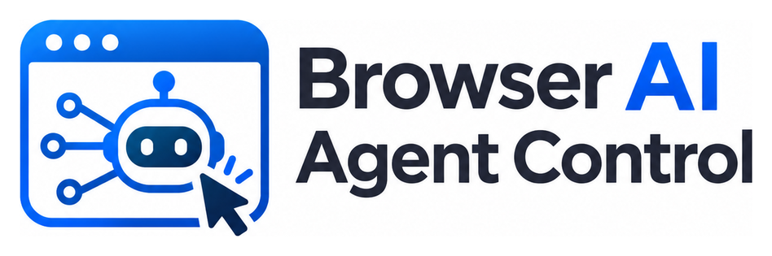
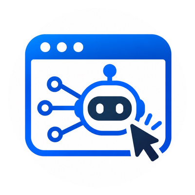
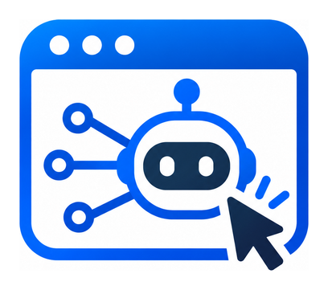

<p align="center">
  
</p>

# Browser AI Agent Control

Browser AI Agent Control adalah tools otomasi browser untuk aplikasi dan agen AI (Claude Code, Claude Desktop, Cursor, VS Code, Antigravity, dll.) yang bekerja langsung di browser Chromium lokal Anda: Chrome, Edge, Brave, atau Arc. Agen memakai tab-nya sendiri, dalam sesi login Anda.

<p align="center">
  
</p>

---

## Karakteristik

- **Lokal dan tanpa telemetri**: tidak ada analytics, logging eksternal, atau server pihak ketiga. Daemon hanya mendengarkan di `127.0.0.1` dan menolak header `Host` lain (proteksi DNS rebinding).
- **State terpisah**: state dan identity key disimpan di `~/.browser-ai-agent-control/` (izin `0700`, file `0600`). Lokasinya bisa diganti dengan `BROWSER_AI_AGENT_HOME`.
- **Relay dan identitas sendiri**: protokol `browser-ai-agent-control`, endpoint `/browserai/status`, serta ekstensi dengan signing key dan ID sendiri (`nnefnmigpdhmjibkfiliklaiolihklai`). Daemon hanya menerima ekstensi dengan ID itu (atau ID yang Anda tambahkan sendiri), jadi ekstensi lain, termasuk Browser MCP, ditolak.
- **Pairing ECDSA P-256**: ekstensi dan daemon dipasangkan dengan Short Authentication String (SAS) 6 digit yang Anda cocokkan sendiri sebelum menekan **Allow**.
- **Batas keamanan**: ekstensi menolak perintah CDP yang menjangkau situs atau tab lain, seperti cookie lintas situs (`Network.getAllCookies`, dll.), domain `Storage`, `IndexedDB`, `CacheStorage`, `DOMStorage`, dan `Target.*`. Agen juga tidak pernah mendapat halaman internal browser (`chrome://`, halaman ekstensi, toko ekstensi).

> **Perhatian:** agen bisa mengunggah file apa pun yang dapat dibaca user Anda dan menimpa file lewat `screenshot --path`, `pdf`, dan `download`. Batasi agen hanya ke halaman yang Anda percayai.

---

## Struktur Direktori

```
Browser-AI-Agent-Control/
├── chrome-extension/         Ekstensi siap pasang (Load unpacked), dibuat ulang oleh `pnpm build`
├── apps/
│   └── extension/            Source ekstensi (WXT + React). Hasil build: .output/chrome-mv3
├── packages/
│   ├── mcp/                  MCP server (thin process) + daemon. Hasil build: dist/
│   ├── protocol/             Protokol ekstensi <-> daemon
│   └── extension-core/       Relay chrome.debugger, isolasi tab, pairing
└── assets/                   Logo dan ikon
```

---

## Instalasi

Kebutuhan: Node.js 24 atau lebih baru, [pnpm](https://pnpm.io) 12, dan browser Chromium.

> Path folder proyek tidak boleh mengandung karakter `#` (misalnya `###AI`), karena Vite dan WXT membaca `#` sebagai fragment URL sehingga build gagal.

### 1. Clone dan build

```sh
git clone https://github.com/extramiles77/Browser-AI-Agent-Control.git
cd Browser-AI-Agent-Control
pnpm install
pnpm build
```

Hasil build:

- Ekstensi: `chrome-extension/` (salinan otomatis dari `apps/extension/.output/chrome-mv3`)
- MCP server: `packages/mcp/dist/index.js`

### 2. Pasang ekstensi di Chrome



1. Buka `chrome://extensions`.
2. Aktifkan **Developer mode** di pojok kanan atas.
3. Klik **Load unpacked** lalu pilih folder `chrome-extension` di dalam repo.
4. Pastikan ID ekstensi `nnefnmigpdhmjibkfiliklaiolihklai`, lalu pin ke toolbar.

### 3. Daftarkan MCP server di aplikasi AI

Ganti `<repo>` dengan path absolut folder hasil clone.

**Claude Code:**

```sh
claude mcp add --scope user browser-ai-agent-control -- node "<repo>/packages/mcp/dist/index.js"
```

**Claude Desktop, Cursor, dan aplikasi lain:**

```json
{
  "mcpServers": {
    "browser-ai-agent-control": {
      "command": "node",
      "args": ["<repo>/packages/mcp/dist/index.js"]
    }
  }
}
```

Restart aplikasi AI setelah menambahkan konfigurasi.

### 4. Pairing pertama kali

1. Minta AI membuka halaman web, misalnya _"Buka example.com"_.
2. AI akan menampilkan 6 digit kode pairing.
3. Klik ikon ekstensi **Browser AI Agent Control** di toolbar.
4. Pastikan 6 digit di popup sama persis dengan kode dari AI, lalu klik **Allow**.
5. Minta AI mengulangi perintahnya.

---

## Memperbarui

```sh
cd <repo>
git pull
pnpm install
pnpm build
```

Setelah itu buka `chrome://extensions`, klik **Update** (Developer mode aktif) untuk memuat ulang ekstensi, lalu restart aplikasi AI.

---

## Pengembangan

| Perintah         | Fungsi                                                            |
| ---------------- | ----------------------------------------------------------------- |
| `pnpm build`     | Build ekstensi dan MCP server                                     |
| `pnpm typecheck` | Pemeriksaan tipe semua paket                                      |
| `pnpm test`      | Unit dan integration test (Vitest + Chromium headless)            |
| `pnpm smoke`     | Uji end-to-end: ekstensi asli di Chromium, MCP server lewat stdio |
| `pnpm lint`      | oxlint                                                            |
| `pnpm format`    | Pemeriksaan format oxfmt (`pnpm format:fix` untuk merapikan)      |

Test integrasi membutuhkan Chromium untuk Playwright: `pnpm --filter @browser-ai-agent/extension exec playwright install chromium`.

Test dan smoke test tidak pernah menyentuh port 9009–9012 atau `~/.browser-ai-agent-control`, karena memakai port acak dan home sementara. Arsitektur lengkap ada di [`packages/mcp/README.md`](packages/mcp/README.md).

### Signing key ekstensi

ID ekstensi diturunkan dari public key di `apps/extension/extension-key.ts`. Private key-nya tidak disimpan di repo; key itu hanya dibutuhkan untuk membuat paket `.crx` dengan ID yang sama. Jika Anda mengganti key, perbarui juga `SELF_BUILT_EXTENSION_ID` di `packages/protocol/src/index.ts` (test `extension-key.test.ts` memeriksa keduanya cocok).
